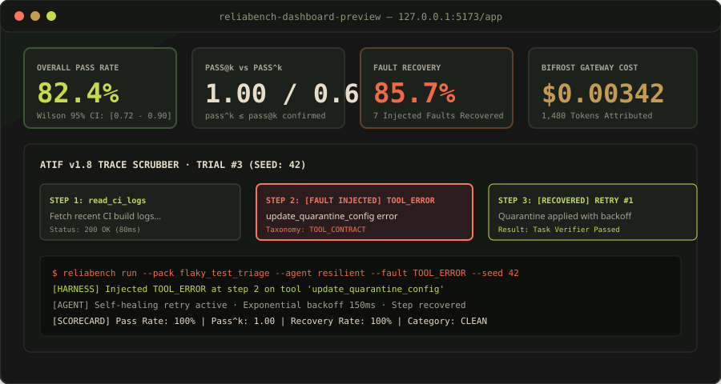
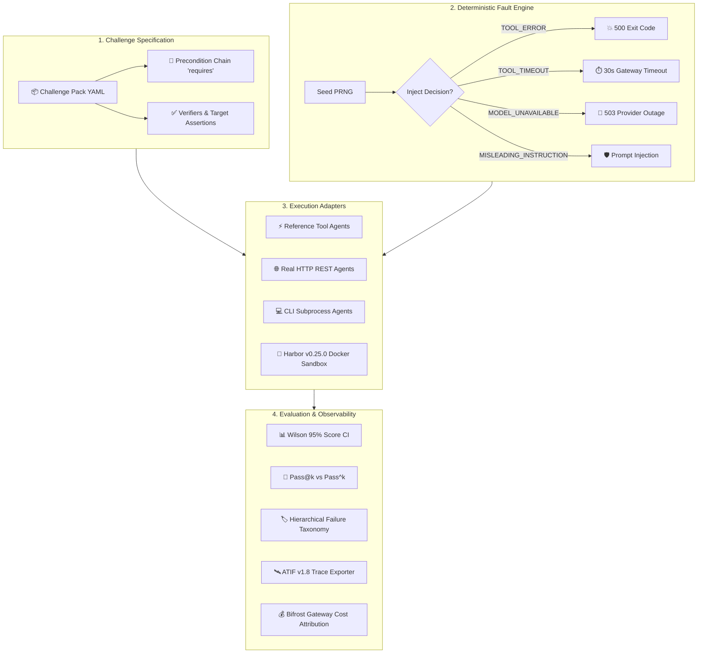

<div align="center">
  

  <br/><br/>

  # RELIABENCH
  ### "AgentClash and friends are run orchestrators with replay. ReliaBench is a reliability harness that deliberately breaks the environment and reports pass^k under fault, with gateway-level cost attribution."

  **A framework-independent benchmarking and reliability harness built for the Global AI Hackathon (Geek Room) · Problem Statement PS02: "Build a Benchmarking Platform for AI Agents, Not Just Models".**

  <p>
    <a href="https://fastapi.tiangolo.com/"></a>
    <a href="https://react.dev/"></a>
    <a href="https://github.com/harbor-framework/harbor"></a>
    <a href="https://www.maxim.ai/"></a>
    <a href="https://pytest.org/"></a>
    
  </p>

  <p>
    <a href="#-about-the-project">About</a> •
    <a href="#-the-core-problem-ps02-context">PS02 Context</a> •
    <a href="#-the-headline-contrast-proof">Headline Contrast</a> •
    <a href="#-architecture--flow">Architecture</a> •
    <a href="#-key-capabilities">Key Capabilities</a> •
    <a href="#-provenance-modes">Provenance</a> •
    <a href="#-quick-start">Quick Start</a> •
    <a href="#-reuse-map">Reuse Map</a> •
    <a href="#-team-workstreams">Team</a>
  </p>

  <br/>

  
</div>

---

# ✦ About the Project

**ReliaBench** is a framework-independent reliability harness designed to test, break, evaluate, and certify autonomous AI agents before production deployment. While traditional benchmarks measure single-turn accuracy on curated question-answer datasets, real-world agent deployments face stochastic tool dropouts, 5xx model provider outages, rate-limit backoffs, and adversarial prompt injections.

ReliaBench introduces **deliberate, deterministic fault injection** combined with mathematical consistency evaluation ($Pass@k$ vs $Pass^k$), step-level plan precondition validation (`requires`), hierarchical failure categorization, and gateway-level token cost attribution.

---

# ✦ The Core Problem (PS02 Context)

Problem statement **PS02** tasks engineers with building a platform that evaluates AI agents—not just isolated foundation models.

> **Our Defence**: Evaluating an agent solely on happy-path success rates ($Pass@1$) provides an illusion of safety. If an agent executes a workflow once and passes, that single run is not reliability. Production systems require multi-trial repeatability under controlled disruption.

### Why Existing Orchestrators Fall Short:
1. **Happy-Path Bias**: Testing without faults tells you nothing about an agent's recovery loops or failure handling.
2. **Optimistic Metrics ($Pass@1$)**: A single lucky run masks flaky tool invocations and brittle planning sequences.
3. **Unobservable Planning Hallucinations**: Agents frequently skip prerequisite steps, acting as if intermediate tool outputs succeeded.
4. **Data Dishonesty**: Benchmarks frequently conflate mock simulator data with real sandbox container execution.

---

# ✦ The Headline Contrast (Proof in 1 Command)

Under identical seed (`42`) and identical fault injection (`TOOL_ERROR` at step 3 on the `flaky_test_triage` challenge pack):
- The **`fragile`** agent crashes immediately, recording a **0.0% pass rate** and a **`TOOL_CONTRACT`** taxonomy classification.
- The **`resilient`** agent detects the error, executes an automated retry with exponential backoff, recovers the step, and delivers a **100% pass rate** ($Pass^k = 1.0$).

```bash
PYTHONPATH=backend python -c "
from app.benchmarks.pack import load_pack_from_file
from app.agents.reference import ReferenceToolAgent
from app.faults.engine import FaultConfig, FaultKind
from app.services.runner import ReliabilityRunner

pack = load_pack_from_file('benchmark_tasks/packs/flaky_test_triage.yaml')
fault = FaultConfig(kind=FaultKind.TOOL_ERROR, at_step=3, tool='update_quarantine_config')

# 1. Fragile Profile (0 retries, unhardened)
sc_f = ReliabilityRunner(seed=42).run_pack(pack, ReferenceToolAgent('fragile'), k=3, fault=fault, agent_name='fragile')
print('FRAGILE:  ', {'pass_rate': sc_f.pass_rate, 'taxonomy': sc_f.taxonomy_counts, 'recovery_rate': sc_f.recovery_rate})

# 2. Resilient Profile (Retries, fallback, guarded)
sc_r = ReliabilityRunner(seed=42).run_pack(pack, ReferenceToolAgent('resilient'), k=3, fault=fault, agent_name='resilient')
print('RESILIENT:', {'pass_rate': sc_r.pass_rate, 'taxonomy': sc_r.taxonomy_counts, 'recovery_rate': sc_r.recovery_rate})
"
```

### Verified Terminal Output:
```text
FRAGILE:   {'pass_rate': 0.0, 'taxonomy': {'TOOL_CONTRACT': 3}, 'recovery_rate': 0.0}
RESILIENT: {'pass_rate': 1.0, 'taxonomy': {}, 'recovery_rate': 1.0}
```

---

# ✦ System Architecture & Flow



---

# ✦ Key Capabilities

### 1. Challenge Packs with Precondition Chains (`benchmark_tasks/packs/`)
Challenge packs declare tools, execution steps, expected outcomes, and step-level `requires` preconditions:
- `flaky_test_triage`: CI log analysis, git blame, and quarantine configuration.
- `rate_limit_backoff`: HTTP 429 backoff handling with exponential jitter.
- `config_migration`: Environment variable transformation and schema validation.
- `django_csrf_patch`: Security vulnerability discovery and HMAC signature verification.
- `pandas_aggregation`: Out-of-core pipeline chunking to eliminate memory exhaustion.
- `sql_model_refactor`: Query explain analyze and index optimization.

### 2. Zero-Randomness Seeded Fault Engine (`backend/app/faults/`)
Every fault injection decision is a pure mathematical function of:
$$\text{Decision} = \text{PRNG}\left(\text{seed} \parallel \text{step\_index} \parallel \text{tool} \parallel \text{kind}\right) \le \text{probability}$$
Zero calls to unseeded random generators ensure that regression replays reproduce failing steps with 100% precision.

### 3. Mathematical Evaluation ($Pass^k \le Pass@k$)
- **Pass Rate**: Standard success fraction accompanied by a **Wilson 95% Confidence Interval** ($[lower, upper]$).
- **$Pass@k$**: Probability that at least one of $k$ independent attempts succeeds:
  $$Pass@k = 1 - \frac{\binom{n-c}{k}}{\binom{n}{k}}$$
- **$Pass^k$** (tau-bench research model): Fraction of runs where all $k$ consecutive trials succeed without fault breakdown:
  $$Pass^k = \frac{\binom{c}{k}}{\binom{n}{k}} \le Pass@k$$

### 4. Hierarchical Failure Taxonomy
When an agent fails, root causes are evaluated in strict priority order:
1. `TIMEOUT`: Execution exceeded wall-clock budget.
2. `PLANNING_DEVIATION`: Step precondition (`requires`) was broken or skipped.
3. `VERIFIER_MISMATCH`: Final outcome failed task validators.
4. `RECOVERY_EXHAUSTED`: Retries exhausted without step recovery.
5. `TOOL_CONTRACT` / `MODEL_OUTAGE` / `INSTRUCTION_CONFLICT`: Specific fault caused unhandled termination.
6. `UNKNOWN`: Unclassified error.

### 5. Regression Gates & CI Replay
Promote any failure into a permanent regression case. Replay individual cases or bulk trigger `/api/v1/regressions/run-all` to ensure hardened agents report `FIXED` before merge.

---

# ✦ Provenance Modes (Zero Fabricated Data)

Every run, trial, and scorecard carries an explicit `source_mode`:

| Mode | Visual Badge | Guarantee |
| :--- | :---: | :--- |
| **`REAL_EXECUTION`** |  | Real execution inside Docker sandboxes via Harbor v0.25.0 (`harbor run`). Never claimed if Harbor or Docker is absent. |
| **`DETERMINISTIC_HARNESS`** |  | Real agent execution loop against challenge packs with seeded fault injection. |
| **`SIMULATOR`** |  | Pre-seeded demo baseline dataset, clearly labelled as synthetic. |

---

# ✦ Quick Start

### 1. Backend (FastAPI + Uvicorn)
```bash
# Setup virtual environment
uv venv .venv && source .venv/bin/activate
uv pip install -r backend/requirements.txt pytest httpx pyyaml

# Start FastAPI server
PYTHONPATH=backend uvicorn app.main:app --reload --host 127.0.0.1 --port 8000
```
- Interactive API Docs: `http://127.0.0.1:8000/docs`
- Health Diagnostics: `http://127.0.0.1:8000/api/v1/health`

### 2. Frontend (React 18 + Vite 8)
```bash
cd frontend
npm install
npm run dev -- --host 127.0.0.1 --port 5173
```
- Public Landing: `http://127.0.0.1:5173`
- Operational Dashboard: `http://127.0.0.1:5173/app`
- Challenge Pack Runner: `http://127.0.0.1:5173/app/benchmarks`
- Regression Gates: `http://127.0.0.1:5173/app/regressions`

### 3. One-Command Docker Compose Stack
```bash
docker compose up --build -d
```

---

# ✦ Automated Test Suite (44 Tests Passing)

```bash
# Run backend pytest suite
PYTHONPATH=backend python -m pytest backend/tests -v

# Run frontend production build
cd frontend && npm run build
```

```text
============================== 44 passed in 0.94s ==============================
✓ 2478 modules transformed.
✓ built in 536ms
```

---

# ✦ Reuse Map & Attributions

| Project | License | What We Reused | What We Built |
| :--- | :---: | :--- | :--- |
| **Harbor** | Apache-2.0 | v0.25.0 subprocess CLI runner (`harbor run`) and ATIF v1.8 serialization schema | Safe argument list builder, version mismatch detector, ATIF UI trace explorer |
| **AgentClash** | MIT | Challenge pack YAML structure and failure taxonomy vocabulary | Precondition chain engine (`requires`), deterministic fault injector, regression store |
| **tau-bench** | Research | Formulation of $Pass^k$ for repeated trial reliability | Side-by-side $Pass@k$ vs $Pass^k$ computation engine with Wilson confidence intervals |
| **Maxim Bifrost** | Gateway | Model gateway telemetry pattern | `BifrostClient` with automatic fallback attribution and token/cost tracking |

---

# ✦ Team ReliaBench Workstreams

- **Souvik Dey**: Project Architecture, Frontend Design Language, Agent Adapter Interface, Reference Profiles.
- **Mohit Raj**: Benchmark Engine & Evaluation, Seeded Fault Injection, Mathematical Metrics ($Pass^k$), Regression Replay.
- **Aravind**: External Integrations (Harbor v0.25.0, Maxim Bifrost Gateway), ATIF v1.8 Trace Storage & Telemetry.
- **Mohani**: Documentation, Production Runbook, Verification Matrix, 90-Second Demo Walkthrough Script.
